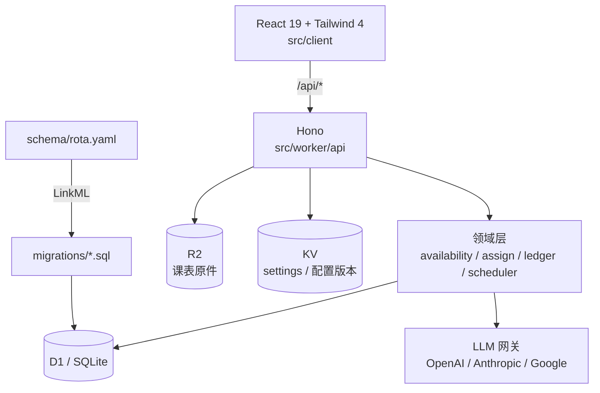

# Project.Rota

**在正确的时间，把活派给对的人。**

面向学生组织的排班系统：读入每个人的课表，算出谁真的有空，把「活」排给最该排的人，并且保证雨露均沾——不是本周均沾，是跨周、跨月都不掉队。

> `rota` = 轮值表。取名直白，因为这件事的本质就是一个不断滚动的轮值表，而不是一个通讯录。

## 现在能做什么

| 能力 | 状态 |
| --- | --- |
| 领域本体（24 张表，LinkML 单一源） | ✅ |
| 学期 / 节次 / 格子（20 周 × 7 天 × 12 节） | ✅ |
| 人员、部门、角色、一人多部门（带任期） | ✅ |
| 课程与课表，按人选课、按周展开 | ✅ |
| 单双周 / 周段 / 调课 | ✅ |
| 可用性计算（课表 + 请假 + 跨部门占用） | ✅ |
| 一次性 / 周期 / 长期任务与班次 | ✅ |
| 试排（候选 + 打分明细 + 排除原因） | ✅ |
| 分配 / 撤销 / 整任务自动排 | ✅ |
| 公平账本（跨窗口结转、冷却、饥饿补偿） | ✅ |
| 课表导入：Excel / CSV / ICS / 截图（视觉模型） | ✅ |
| 模型供应商后台配置 + 热切换 | ✅ |
| CSV 导出（班表 / 公平） | ✅ |
| 响应式 Web 界面（手机底部 tab / 桌面侧栏） | ✅ |
| 账号体系（id.plutokeating.beer OIDC） | 🚧 占位，见 [docs/ARCHITECTURE.md](docs/ARCHITECTURE.md#7-鉴权) |
| 邮件 / 短信通知 | ❌ 未做，v1 只做导出 |

当前是 **v1：功能闭环**。本机验证覆盖 46 个测试（含真实 SQL 的端到端流程），但 `pnpm dev` 在 Android/proot 下起不来（workerd 限制），见 QUICK_START。

## 五分钟上手

```bash
pnpm install
pnpm db:local     # 建本地 D1
pnpm dev          # http://localhost:5173（普通 Linux/macOS）
```

界面里按这个顺序走：

1. **学期** → 新建：填开学日、周数、节次表（会生成整学期的格子）。
2. **人员** → 新建人员；**组织** → 建部门；给人员加成员关系。
3. **课表** → 选人 → 添加课程（星期、节次、单双周/周段）。
4. **任务** → 新建任务 → 加一个班次，或按周生成。
5. **排班** → 点班次「试排」→ 看候选分数与排除原因 → 确认分配。
6. **公平** → 看谁排少了；**导出**拿 CSV 发群。

课表也可以直接 **导入**：Excel / CSV / ICS / 截图，解析完先进「待确认」，确认后才落库。

## 架构



三层约束：**本体层**定义数据长什么样，**领域层**只吃普通对象（不碰 D1 / Hono），**接口层**负责拼装与审计。所以打分逻辑能在 Node 里直接跑真实 SQL 的集成测试，也能整体替换成求解器。

## 文档

| 文档 | 内容 |
| --- | --- |
| [docs/ONTOLOGY.md](docs/ONTOLOGY.md) | 为什么表结构长这样：一人多部门、时间网格、公平账本 |
| [docs/ARCHITECTURE.md](docs/ARCHITECTURE.md) | 分层、请求路径、导入 / 排班 / 结转流程、ADR |
| [docs/API.md](docs/API.md) | 接口契约 |
| [docs/QUICK_START.md](docs/QUICK_START.md) | 安装、本地跑、部署、排错 |
| [docs/er.md](docs/er.md) | 自动生成的 ER 图 |
| [AGENTS.md](AGENTS.md) | Agent 开发规范 |

## 三个关键设计

**1. 一人多部门，靠 Membership 而不是外键。**
`person` 上不存 `department_id`。归属本身是一张带角色、带任期的表（对应 W3C ORG 的 `org:Membership`），所以「同时在宣传部和办公室」「这学期转岗」都是自然表达。

**2. 单双周落成格子，不落成规则。**
`term × week × weekday × period` 物化成 `slot`，一学期约 1700 行。上课规则展开成 `course_occurrence`；一门课只有一份规则、一份 occurrence，谁选了它由 `enrollment` 表达。匹配时只查表——在 SQL 里算 RRULE 是做不动的。

**3. 公平是账本，不是当场平均。**
`fairness_stat` 按「人 × 组织 × 窗口」累计次数与工时。评分 = 公平缺口 + 饥饿补偿 + 偏好 + 人工优先级 − 近期连排惩罚。每次打分留 `reason`，能回答「为什么是他」，也能回答「为什么不是他」。

## 目录

```
schema/rota.yaml      本体（唯一源）
migrations/           生成的 DDL
src/worker/domain/    可用性、打分、账本、排班
src/worker/api/       Hono 路由
src/worker/import/    Excel / CSV / ICS / 截图解析
src/worker/llm/       模型网关
src/client/           React 界面
test/                 单测 + 真实 SQL 的集成测试
```

## 命名约定

仓库目录、GitHub 仓库、远端名统一为 `Project.<Name>`：`Project` 只有首字母大写，后跟一个英文句点，再接真实名字，如 `Project.Rota`、`Project.eWave`。

## License

[AGPL-3.0-or-later](LICENSE)。
