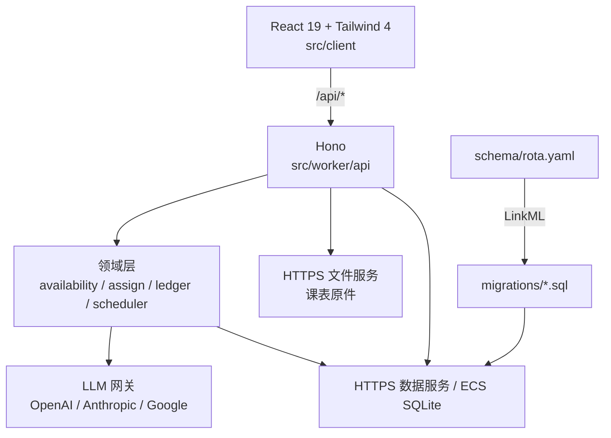

# Project.Rota

**在正确的时间，把活派给对的人。**

面向学生组织的排班系统：读入每个人的课表，算出谁真的有空，把「活」排给最该排的人，并且保证雨露均沾——不是本周均沾，是跨周、跨月都不掉队。

> `rota` = 轮值表。取名直白，因为这件事的本质就是一个不断滚动的轮值表，而不是一个通讯录。

## 现在能做什么

| 能力 | 状态 |
| --- | --- |
| 领域本体（24 张表，LinkML 单一源） | ✅ |
| 学期 / 节次 / 格子（20 周 × 7 天 × 12 节） | ✅ |
| 人员、部门、角色、一人多部门（带任期） | ✅ |
| 课程与课表，按人选课、按周展开 | ✅ |
| 单双周 / 周段 / 单次调课与停课 | ✅ |
| 可用性计算（课表 + 请假 + 跨部门占用） | ✅ |
| 一次性 / 周期 / 长期任务与班次 | ✅ |
| 试排（候选 + 打分明细 + 排除原因） | ✅ |
| 分配 / 撤销 / 整任务自动排 | ✅ |
| 公平账本（跨窗口结转、冷却、饥饿补偿） | ✅ |
| 课表导入：Excel / CSV / ICS / 截图（视觉模型） | ✅ |
| 模型供应商后台配置 + 热切换 | ✅ |
| CSV 导出（班表 / 公平） | ✅ |
| 响应式 Web 界面（手机底部 tab / 桌面侧栏） | ✅ |
| 账号体系（id.plutokeating.beer OIDC） | ✅ PKCE、签名验证、服务端会话、管理员授权 |
| 邮件 / 短信通知 | ❌ 未做，v1 只做导出 |

当前完成 **v1 业务流程与生产认证接入**。自动化验证覆盖真实 SQL 排班、导入事务、OIDC 验签、权限和存储异常；已部署入口为 [Rota](https://project-rota.williamhvollita.workers.dev)。生产仅允许管理员白名单登录。

GitHub Actions 检查提交，Cloudflare Workers Builds 连接仓库后自动构建部署。部署步骤与实际验证边界见 [QUICK_START](docs/QUICK_START.md) 和 [交付进度](docs/PROGRESS.md)。

## 五分钟上手

```bash
pnpm install
cp .dev.vars.example .dev.vars
cp .env.example .env
pnpm data:dev     # 独立终端运行 SQLite / 设置 / 文件服务
pnpm dev          # http://localhost:5173（普通 Linux/macOS）
```

登录即进入 **排班**。点「安排工作」填写名称、部门、时间和人数，可每周重复；创建后就地查看候选、确认分配或批量预览。缺少学期、部门或人员时，可在创建侧栏补充后返回。

日常入口只有 **排班、人员、导入**。点击人员姓名查看课表与请假；导入支持课表文件人工确认和人员清单粘贴预览。校历、规则、模型、授权和审计位于「管理」。模型从 models.dev 目录勾选，粘贴密钥后加密保存，可测试、启停和排序。

界面与接口说明见 [前端模块](src/client/docs/README.md)、[Worker 模块](src/worker/docs/README.md) 和 [设计系统](DESIGN.md)。

## 架构



**本体层**定义业务数据，纯评分函数处理普通对象，排班与可用性服务通过 HTTPS 访问 ECS SQLite，**接口层**负责权限、拼装与审计。测试在 Node.js 24 的真实 SQLite 上执行。

## 文档

| 文档 | 内容 |
| --- | --- |
| [docs/ONTOLOGY.md](docs/ONTOLOGY.md) | 为什么表结构长这样：一人多部门、时间网格、公平账本 |
| [docs/ARCHITECTURE.md](docs/ARCHITECTURE.md) | 分层、请求路径、导入 / 排班 / 结转流程、ADR |
| [docs/API.md](docs/API.md) | 接口契约 |
| [docs/QUICK_START.md](docs/QUICK_START.md) | 安装、本地跑、部署、排错 |
| [docs/er.md](docs/er.md) | 自动生成的 ER 图 |
| [AGENTS.md](AGENTS.md) | Agent 开发规范 |

## 三个关键设计

**1. 一人多部门，靠 Membership 而不是外键。**
`person` 上不存 `department_id`。归属本身是一张带角色、带任期的表（对应 W3C ORG 的 `org:Membership`），所以「同时在宣传部和办公室」「这学期转岗」都是自然表达。

**2. 单双周落成格子，不落成规则。**
`term × week × weekday × period` 物化成 `slot`，一学期约 1700 行。上课规则展开成 `course_occurrence`；一门课只有一份规则、一份 occurrence，谁选了它由 `enrollment` 表达。匹配时只查表——在 SQL 里算 RRULE 是做不动的。

**3. 公平是账本，不是当场平均。**
`fairness_stat` 按「人 × 组织 × 窗口」累计次数与工时。评分 = 公平缺口 + 饥饿补偿 + 偏好 + 人工优先级 − 近期连排惩罚。每次打分留 `reason`，能回答「为什么是他」，也能回答「为什么不是他」。

## 目录

```
schema/rota.yaml      本体（唯一源）
migrations/           初始 DDL 与增量迁移
src/worker/domain/    可用性、打分、账本、排班
src/worker/api/       Hono 路由
src/worker/import/    Excel / CSV / ICS / 截图解析
src/worker/llm/       模型网关
src/client/           React 界面
storage/              ECS 数据服务、在线备份与容器镜像
test/                 单测 + 真实 SQL 的集成测试
```

## 命名约定

仓库目录、GitHub 仓库、远端名统一为 `Project.<Name>`：`Project` 只有首字母大写，后跟一个英文句点，再接真实名字，如 `Project.Rota`、`Project.eWave`。

## License

[AGPL-3.0-or-later](LICENSE)。
