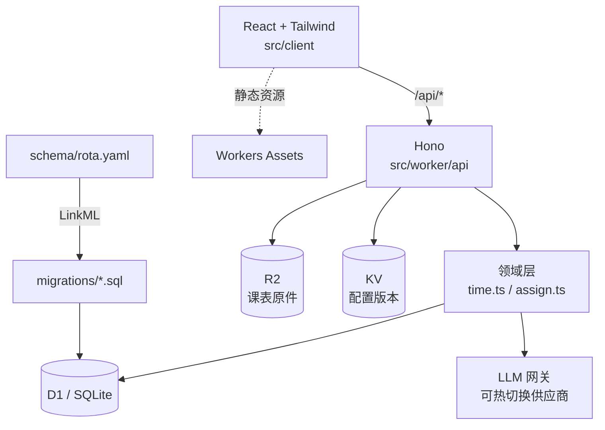

# Project.Rota

**在正确的时间，把活派给对的人。**

面向学生组织的排班系统：读入每个人的课表，算出谁真的有空，把「活」排给最该排的人，并且保证雨露均沾——不是本周均沾，是跨周、跨月都不掉队。

> `rota` = 轮值表。取名直白，因为这件事的本质就是一个不断滚动的轮值表，而不是一个通讯录。

## 现状

| 能力 | 状态 |
| --- | --- |
| 领域本体（23 张表，LinkML 单一源） | ✅ |
| LinkML → SQL DDL / ER 图 / JSON Schema | ✅ |
| 校历网格、单双周 / 周段展开 | ✅ |
| 公平打分 + 冷却 + 饥饿补偿 | ✅ |
| Hono API | 🚧 `/api/health`、`/api/terms` |
| React 界面 | 🚧 骨架 |
| 课表导入（Excel / ICS / 截图） | 🚧 设计完成，未实现 |
| 模型供应商热切换 | 🚧 设计完成，未实现 |
| OIDC 登录（id.plutokeating.beer） | 🚧 设计完成，未实现 |

当前是 **M0：骨架 + 本体 + 核心算法**。能跑、能测，但还不能真正排班。

## 架构



三层约束：**本体层**定义数据长什么样，**领域层**只吃普通对象（不碰 D1 / Hono），**接口层**负责鉴权与拼装。所以打分逻辑能在 Node 里直接单测，也能整体替换成求解器。

## 快速开始

```bash
pnpm install
pnpm dev          # http://localhost:5173
pnpm test         # 29 个领域层单测
```

本地建库、部署、改 schema 的完整步骤见 [docs/QUICK_START.md](docs/QUICK_START.md)。

## 文档

| 文档 | 内容 |
| --- | --- |
| [docs/ONTOLOGY.md](docs/ONTOLOGY.md) | 为什么表结构长这样：一人多部门、时间网格、公平账本 |
| [docs/ARCHITECTURE.md](docs/ARCHITECTURE.md) | 分层、请求路径、导入 / 排班 / 结转三条流程、ADR |
| [docs/API.md](docs/API.md) | 接口契约（含待实现部分） |
| [docs/QUICK_START.md](docs/QUICK_START.md) | 安装、本地跑、部署 |
| [docs/er.md](docs/er.md) | 自动生成的 ER 图（Mermaid） |
| [AGENTS.md](AGENTS.md) | Agent 开发规范 |

## 三个关键设计

**1. 一人多部门，靠 Membership 而不是外键。**
`person` 上不存 `department_id`。归属本身是一张带角色、带任期的表（对应 W3C ORG 的 `org:Membership`），所以「同时在宣传部和办公室」「这学期转岗」都是自然表达。

**2. 单双周落成格子，不落成规则。**
`term × week × weekday × period` 物化成 `slot`，一学期约 1700 行。上课规则（每周 / 单周 / 双周 / 第 1–8 周）展开成 `course_occurrence`。匹配时只查表——在 SQL 里算 RRULE 是做不动的。

**3. 公平是账本，不是当场平均。**
`fairness_stat` 按「人 × 组织 × 窗口」累计次数与工时，并保留 `carry_over`。评分 = 公平缺口 + 饥饿补偿 + 偏好 + 人工优先级 − 近期连排惩罚。每次打分留 `reason`，能回答「为什么是他」，也能回答「为什么不是他」。

## 目录

```
schema/rota.yaml      本体（唯一源）
migrations/           生成的 DDL
src/worker/domain/    校历展开、公平打分
src/worker/api/       Hono 路由
src/client/           React 界面
docs/                 架构、本体、API、上手
test/                 领域层单测
```

## 命名约定

仓库目录、GitHub 仓库、远端名统一为 `Project.<Name>`：

- `Project` 只有首字母大写，后面跟一个英文句点；
- `<Name>` 是项目的真实名字，如 `Project.Rota`、`Project.eWave`。

## License

AGPL-3.0-or-later（与 `Project.eWave` 一致）。`LICENSE` 文件待确认后补入。
